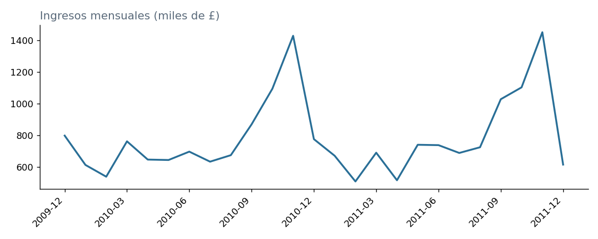
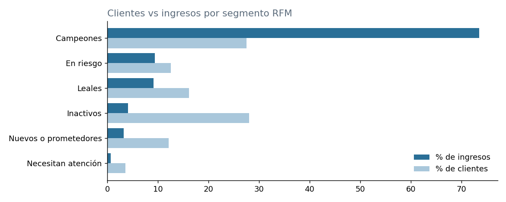
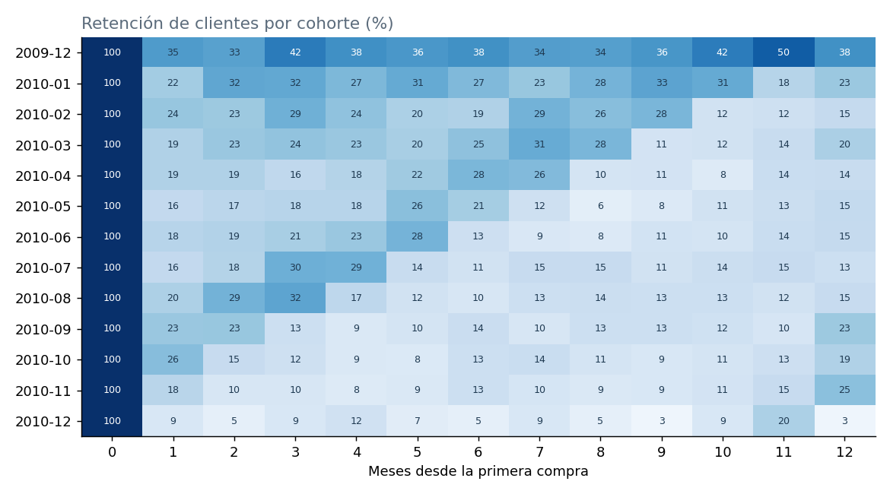
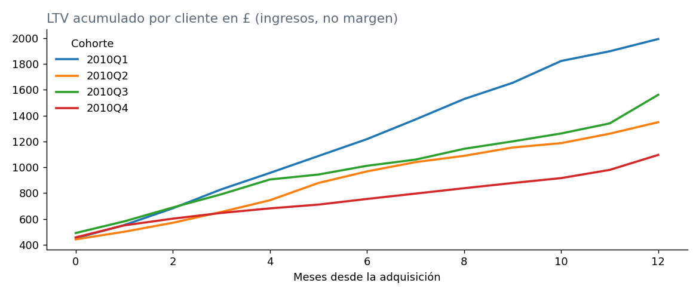

# Análisis de clientes de eCommerce: RFM, cohortes y LTV

Análisis de una tienda online minorista (Reino Unido) para entender **quiénes compran, cuánto valen y quiénes dejan de comprar**, y proponer acciones de retención. Hecho con SQL (SQLite), Python (pandas, matplotlib) y datos públicos.

## Preguntas que responde

1. ¿Cómo evolucionan los ingresos, las facturas y el ticket promedio por mes?
2. ¿Qué países y productos concentran las ventas?
3. ¿Qué tan concentrado está el ingreso en pocos clientes?
4. ¿Cómo se segmentan los clientes según recencia, frecuencia y monto (RFM)?
5. ¿Cuánto de cada cohorte de clientes nuevos sigue comprando después?
6. ¿Cuál es el valor acumulado (LTV) por cliente a 12 meses, según cuándo fue adquirido?

## Datos

[Online Retail II](https://archive.ics.uci.edu/dataset/502/online+retail+ii) (UCI Machine Learning Repository, licencia CC BY 4.0): transacciones reales del 1 de diciembre de 2009 al 9 de diciembre de 2011. Tras la limpieza quedan 1.003.214 líneas de venta, 39.516 facturas y 5.852 clientes identificados, con ingresos de £19,64 millones.

**Limpieza (`prep.py`):** se eliminan 34.335 filas duplicadas y los códigos que no son productos (envíos, ajustes, comisiones bancarias, pruebas), se separan las devoluciones (facturas que empiezan por "C") y se conservan solo ventas con cantidad y precio positivos. El 13,1 % del ingreso (£2,57 M) no tiene ID de cliente: cuenta en las métricas de ingresos, pero no en las de clientes (RFM, cohortes, LTV).

## Cómo reproducirlo

```bash
pip install -r requirements.txt
# Descargar online_retail_II.xlsx desde el enlace de arriba (dentro del .zip) y dejarlo en esta carpeta
python prep.py online_retail_II.xlsx   # limpia y crea retail.sqlite
python analysis.py                     # ejecuta queries.sql, exporta CSV y genera los gráficos
```

## Resultados

- **Estacionalidad fuerte:** las ventas suben de septiembre a noviembre (noviembre de 2010: £1,43 M; noviembre de 2011: £1,45 M) y caen en enero y febrero.
- **Concentración geográfica:** Reino Unido aporta el 85,5 % del ingreso. Irlanda (EIRE) es segundo con el 3,2 %, pero con solo 3 clientes identificados.
- **Producto líder:** *Regency Cakestand 3 Tier* (£330.590), seguido por *White Hanging Heart T-Light Holder* (£257.725).
- **Devoluciones:** 2,5 % de las ventas en 2010 y 4,8 % en 2011.
- **Concentración de clientes:** el 20 % de los clientes genera el 77,2 % del ingreso.
- **Segmentos RFM:**

| Segmento | Clientes | % clientes | % ingresos |
|---|---|---|---|
| Campeones | 1.611 | 27,5 % | 73,5 % |
| En riesgo | 735 | 12,6 % | 9,4 % |
| Leales | 943 | 16,1 % | 9,1 % |
| Inactivos | 1.643 | 28,1 % | 4,1 % |
| Nuevos o prometedores | 711 | 12,1 % | 3,3 % |
| Necesitan atención | 209 | 3,6 % | 0,6 % |

- **Retención:** en promedio, las cohortes de 2010 recuperan alrededor del 19 % de sus clientes al mes 1 y alrededor del 17 % al mes 12. El 27,6 % de los clientes compró una sola vez.
- **LTV a 12 meses (ingresos por cliente, no margen):** cohorte 1T 2010 £1.993; 2T £1.349; 3T £1.561; 4T £1.096.

## Gráficos






## Decisiones de negocio que sugiere el análisis

1. **Proteger a los Campeones** (27,5 % de los clientes, 73,5 % del ingreso): acceso anticipado, programa de lealtad y atención prioritaria.
2. **Reactivar a los clientes "En riesgo"** (735 clientes con £1,6 M de compras históricas), priorizando por monto histórico.
3. **Impulsar la segunda compra** de los clientes nuevos: la retención al mes 1 ronda el 19 % y más de una cuarta parte nunca vuelve. Un flujo de seguimiento a 30–90 días es la palanca más clara.
4. **Planear campañas e inventario desde septiembre**, por la estacionalidad de fin de año.
5. **Revisar la adquisición de temporada alta:** las cohortes del 4T de 2010 muestran menor retención y menor LTV a 12 meses. Una hipótesis (no verificada con estos datos) es que parte de esos clientes compran por regalo. Convendría comparar el costo de adquisición por temporada.

## Limitaciones

- No hay canal de adquisición, costo de marketing ni margen en el dataset, por lo que no se calculan ROAS, CAC ni atribución. El LTV es de **ingresos**, no de margen.
- Diciembre de 2009 es el primer mes de datos, así que la cohorte "2009-12" mezcla clientes nuevos con clientes que ya existían. Diciembre de 2011 está incompleto (hasta el día 9).
- Los puntajes RFM usan umbrales fijos (recencia: 30/90/180/365 días; frecuencia: 2/3/5/9 facturas) para que los resultados sean reproducibles.

## Archivos

- `prep.py`: limpieza y creación de la base SQLite.
- `queries.sql`: 9 consultas con CTEs, funciones de ventana, `CASE` y fechas.
- `analysis.py`: ejecuta las consultas, exporta CSV y genera los gráficos.
- `ingresos_mensuales.png`, `segmentos_rfm.png`, `retencion_cohortes.png`, `ltv_cohortes.png`: imágenes usadas en este README.
